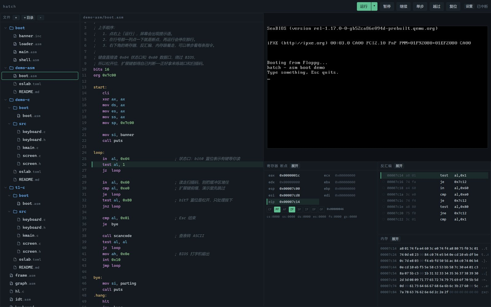
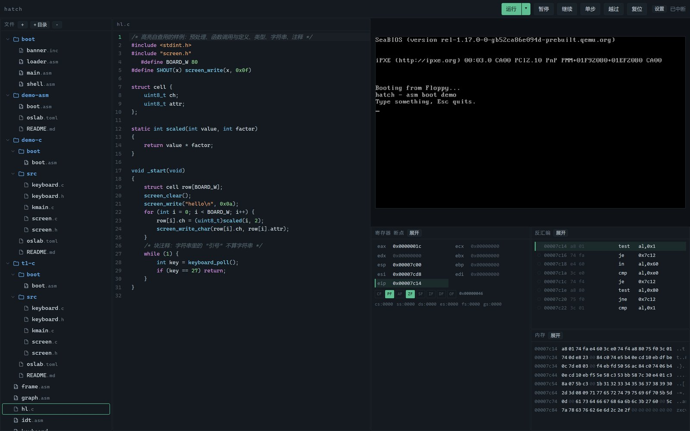
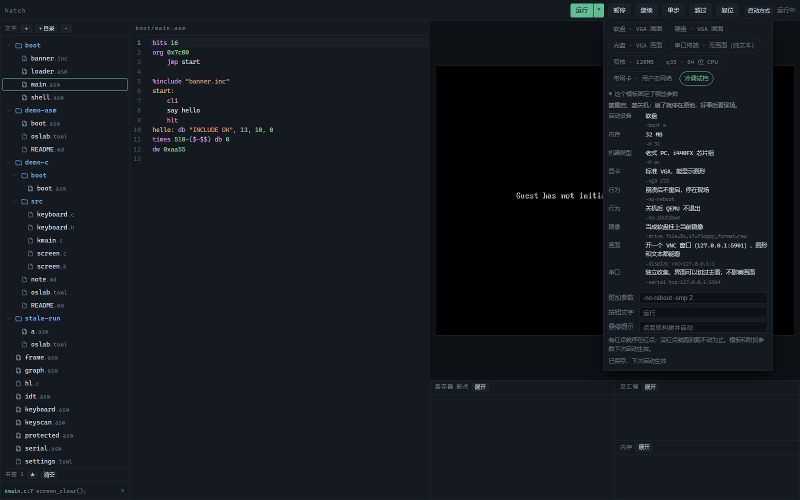
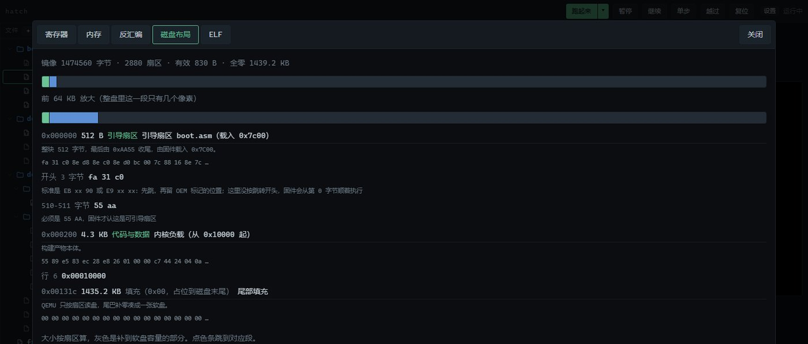
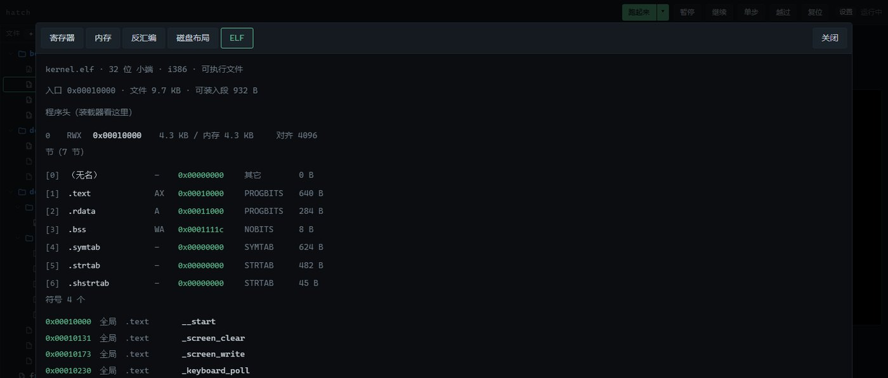
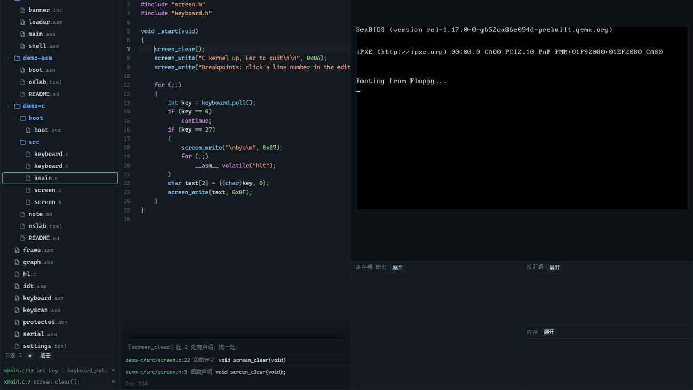
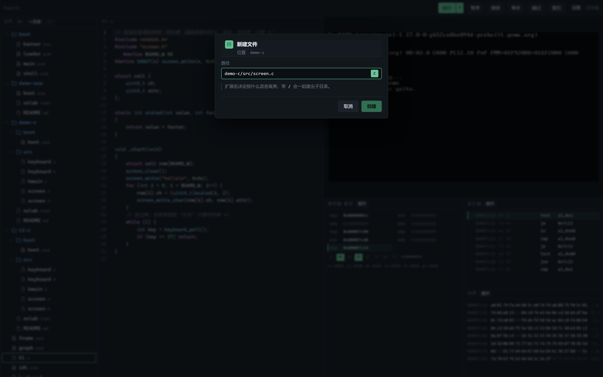

# hatch

在本地窗口里写引导扇区、起机器、下断点、看画面与串口。**写、构建、启动、调试、观测都在一个界面里**——这是它存在的理由，不是教程播放器。



- **写**：CodeMirror 6 编辑器，NASM / C 高亮与补全，保存即校验并标行；点行号就是断点
- **起**：QEMU 无窗口启动，画面走 VNC 32bpp，调试走 GDB 远程协议
- **调**：暂停、单步、越过、断点、寄存器（可写、按位、按宽度）、任意地址内存与反汇编
- **看**：只有一块 VGA 画面，串口独立收着，随时切过去；刷新浏览器不丢会话
- **语言**：汇编直接编；C 走 32 位内核工程（引导扇区 + 链接脚本 + 行号映射）

## 为什么又是 IDE

OS 开发最烦的不是写不出那几十行汇编，而是**验证一次要切五六个窗口**：编辑器、构建终端、QEMU、串口、gdb。每次切换都丢上下文，出错时还得靠猜。hatch 把这些动作压进同一次点击：写 → 启动 → 断点停住 → 看寄存器与反汇编 → 单步 → 看结果，全程不离开这一屏。

## 用起来是什么样

**从模板起手**：内置汇编引导扇区和 32 位 C 内核两个最小例子，点「＋」选模板、给个目录就有了可运行的工程。

**断点是真的断点**：构建完先按行号解析出地址、写好断点再放行，不会跑过头；红点、行高亮、寄存器里的 `eip` 三处对得上，改代码后自动重算。



**QEMU 参数不靠背**：显卡、画面、串口、启动设备这些开关固定在各模板里，选中就把每一项连原参数一起列出来，不让人猜「VGA 到底能不能显示图形」。同一台机器平时软盘跑，要抓崩溃点一下切冷调试档。



**按钮只管跑**：点一下构建并启动，按住 Shift 只构建，旁边 ▾ 里是软复位、重新构建、看镜像结构这些一次性动作。机器怎么起这类长期设置收在「启动方式」里，不占日常视线。

**镜像摊开给你看**：构建完按一下，镜像被拆成引导扇区、代码、填充几段，逐段标偏移、大小、头几个字节；引导扇区里的开头指令、OEM 字节、分区表项、`0xAA55` 签名逐条点名，行号对应的机器码落点也标在偏移上。签名不对、分区越界、镜像不是整扇区都会当场告警。



**ELF 不靠外部工具**：C 工程构建时同时产出 ELF 调试件（地址与镜像一致），面板里读得出文件头、程序头、每一节的权限与对齐、符号表，入口不在可执行节、节既可写又可执行这类毛病直接标红。



**名字上按 Ctrl 就跳过去**：光标停在函数、宏、类型或者 `call`/`jmp` 的标签上，F12（或 Ctrl+B、Ctrl+点击）直接跳到声明；有一处以上就先列出来挑，定义永远排在声明前面，同级里本文件排最前。纯文本找，不用先编译，写一半的文件也能跳。

**书签跨文件**：F11 给当前行打一条，左下角书签栏一直留着，点一条就跳到那个文件的对应行。文件不在了那条会灰掉划掉但不丢，清空按钮在栏头。




**文件树是正经对话框**：新建时按扩展名标出语言，重名、非法字符、保留名当场提示；删除目录会先说清楚连带删几项。



## 三条硬约束

1. **只有一个模拟器实例**：再点「运行」先杀旧进程并等端口释放，启动时也清理残留
2. **刷新浏览器不影响客户机**：画面与串口重新接上并回放，按键状态补发全松开
3. **端口固定**：GDB 5913、串口 5914、VNC 5901，实例锁 5912，冲突时不起第二份

## 快速开始

**机器上什么都不用先装。** 只需要 Python 3.11+ 和一条能上网的线：QEMU、NASM、32 位 gcc 会在首次启动时自己下到 `.work/tools`（约 280 MB，只下一次，不装进系统盘、不写注册表）。

```bash
python -m venv .venv && .venv\Scripts\activate
pip install -e ".[dev]"

hatch              # 开窗口；首次会先把工具备齐
hatch --serve      # 只起服务，浏览器开 http://127.0.0.1:8799
hatch setup        # 只装工具，打印清单和路径，装完退出
```

装完的样子：

```
nasm               就绪  .work\tools\nasm-2.16.03\nasm.exe
qemu-system-i386   就绪  .work\tools\qemu\qemu-system-i386.exe
gcc                就绪  .work\tools\w64devkit\bin\gcc.exe
```

下载走官方地址，带重试；断了重跑 `hatch setup` 即可，装好的不会重下。工具放在项目自己的 `.work/tools` 里（已被不断提交的 `.gitignore` 排除），删掉目录就等于卸载。

公司网络挡住下载时，也可以自己装一份，用 `HATCH_QEMU` / `HATCH_NASM` / `HATCH_GCC` 指过去，优先级高于自动下载。仓库里也提交了带版本锁的 `package.json`，只有改界面才需要 `npm install`。

## 验收

```bash
python -m pytest tests/unit -q      # 工作区、汇编、C 构建、行映射、反汇编、配置、校验
python tests/e2e/selftest.py        # 端到端：目录 CRUD、起机、断点（含 C 行断点）、模板、串口、单实例
```

两项全绿才算可交付。

## 工程清单

带运行含义的目录放一份 `oslab.toml`：

```toml
kind = "c"                                  # c | asm
entry = "src/kmain.c"
sources = ["src/kmain.c", "src/screen.c"]
boot = "boot/boot.asm"                      # 16 位引导扇区
link = "boot/kernel.ld"
```

没有清单的裸 `.asm` 按单文件汇编运行。模板生成出来的 `oslab.toml` 自带逐条注释和改法示例，照着改就行。清单由 `services/project.py` 校验：缺项、类型错、文件不存在、键名写错、`asm` 工程里写只有 C 才用的键、`entry` 不在 `sources` 里、`base` 越界，都当场点名报错。只有 `.asm` 和带清单的 `.c` 能运行，其余后缀会被拒绝并说明原因。

## 启动方式

按钮只做最常用的一件事：构建并启动。按住 Shift 点它是只构建，旁边 ▾ 里是一次性动作（只构建、软复位、重新构建并启动、看磁盘布局、看 ELF 结构），打开就四五行。

机器怎么起属于长期设置，收在「启动方式」这个小浮层里：一排模板 chip 点一下就用它，下面能改按钮文字和悬停提示，要加模板以外的参数写在附加参数里。改了当场存，模板和附加参数下次启动生效。

有红点就停在红点，没红点就跑到跑不动为止，不用另外交代。模板各自固定了哪些参数，点开「这个模板固定了哪些参数」逐条看；模板管「把机器起对起稳」，撞车的参数会被拒并说明原因。

这些只存在工作区的 `settings.toml` 里，不塞进工程目录，也不跟工程清单抢：清单只说「这个工程由哪些文件、怎么链接」，一个工程一份。老清单里如果还留着 `[run]` 段，会直接报错点名是哪几项，删掉那段就好。


## 结构

```
src/oslab/
  core/        状态机与仲裁
  backend/     QEMU / Bochs 适配层
  services/    工作区、构建、汇编、C 工程、行映射、设置、模板
  display/     VNC 帧与 VRAM 渲染
  web/         aiohttp 路由与处理器
  assets/ui/   界面（ES 模块 + 已打包的编辑器）
tools/         打包与补丁脚本
templ/         代码模板
tests/         单元与端到端
```

分层与数据流见 [docs/architecture.md](docs/architecture.md)，文件规则见 [docs/workspace.md](docs/workspace.md)，C 工程见 [docs/c.md](docs/c.md)，跳声明与书签见 [docs/editor.md](docs/editor.md)，布局与 ELF 视图见 [docs/inspect.md](docs/inspect.md)，设计取舍见 [docs/decisions](docs/decisions)。

## 已知限制

- 主要面向 Windows 开发；端口、工具路径按 Windows 习惯写死默认值
- 单实例、单客户机，不做多标签并行
- 不判题、不内置课程，`workspace/` 里的文件就是全部工作单元

## 许可

MIT
