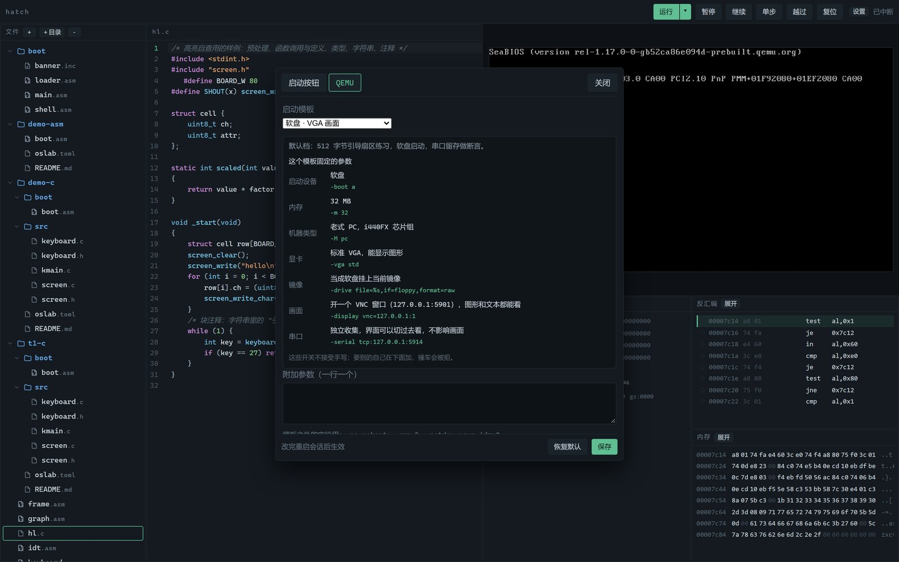

# hatch

在本地窗口里写引导扇区、起机器、下断点、看画面与串口。**写、构建、启动、调试、观测都在一个界面里**——这是它存在的理由，不是教程播放器。


- **写**：CodeMirror 6 编辑器，NASM / C 高亮与补全，保存即校验并标行；点行号就是断点
- **起**：QEMU 无窗口启动，画面走 VNC 32bpp，调试走 GDB 远程协议
- **调**：暂停、单步、越过、断点、寄存器（可写、按位、按宽度）、任意地址内存与反汇编
- **看**：只有一块 VGA 画面，串口独立收着，随时切过去；刷新浏览器不丢会话
- **语言**：汇编直接编；C 走 32 位内核工程（引导扇区 + 链接脚本 + 行号映射）

## 为什么又是 IDE

OS 开发最烦的不是写不出那几十行汇编，而是**验证一次要切五六个窗口**：编辑器、构建终端、QEMU、串口、gdb。每次切换都丢上下文，出错时还得靠猜。hatch 把这些动作压进同一次点击：写 → 启动 → 断点停住 → 看寄存器与反汇编 → 单步 → 看结果，全程不离开这一屏。

## 用起来是什么样

**从模板起手**：内置汇编引导扇区和 32 位 C 内核两个最小例子，点「＋」选模板、给个目录就有了可运行的工程。

**断点是真的断点**：构建完先按行号解析出地址、写好断点再放行，不会跑过头；红点、行高亮、寄存器里的 `eip` 三处对得上，改代码后自动重算。


**QEMU 参数不靠背**：显卡、画面、串口、启动设备这些开关固定在各模板里，选中就把每一项连原参数一起列出来，不让人猜「VGA 到底能不能显示图形」。



**文件树是正经对话框**：新建时按扩展名标出语言，重名、非法字符、保留名当场提示；删除目录会先说清楚连带删几项。


## 三条硬约束

1. **只有一个模拟器实例**：再点「运行」先杀旧进程并等端口释放，启动时也清理残留
2. **刷新浏览器不影响客户机**：画面与串口重新接上并回放，按键状态补发全松开
3. **端口固定**：GDB 5913、串口 5914、VNC 5901，实例锁 5912，冲突时不起第二份

## 快速开始

需要 Python 3.11+，以及这些外装命令（`PATH` 里能找到即可，也可以用 `HATCH_NASM` / `HATCH_QEMU` / `HATCH_GCC` 等环境变量指定）：

| 命令 | 用途 |
| --- | --- |
| `qemu-system-i386` | 运行客户机 |
| `nasm` | 汇编 |
| `gcc` `ld` `objcopy` | 32 位 C 工程 |

```bash
python -m venv .venv && .venv\Scripts\activate
pip install -e ".[dev]"

hatch              # 开窗口
hatch --serve      # 只起服务，浏览器开 http://127.0.0.1:8799
```

界面包已经提交在仓库里，装依赖只为**改**界面时才需要 Node。

## 验收

```bash
python -m pytest tests/unit -q      # 工作区、汇编、C 构建、行映射、反汇编、配置、校验
python tests/e2e/selftest.py        # 端到端：目录 CRUD、起机、断点（含 C 行断点）、模板、串口、单实例
```

两项全绿才算可交付。

## 工程清单

带运行含义的目录放一份 `oslab.toml`：

```toml
kind = "c"                                  # c | asm
entry = "src/kmain.c"
sources = ["src/kmain.c", "src/screen.c"]
boot = "boot/boot.asm"                      # 16 位引导扇区
link = "boot/kernel.ld"
```

没有清单的裸 `.asm` 按单文件汇编运行。清单由 `services/project.py` 校验，缺项、类型错、文件不存在都直说。只有 `.asm` 和带清单的 `.c` 能运行，其余后缀会被拒绝并说明原因。

## 结构

```
src/oslab/
  core/        状态机与仲裁
  backend/     QEMU / Bochs 适配层
  services/    工作区、构建、汇编、C 工程、行映射、设置、模板
  display/     VNC 帧与 VRAM 渲染
  web/         aiohttp 路由与处理器
  assets/ui/   界面（ES 模块 + 已打包的编辑器）
tools/         打包与补丁脚本
templ/         代码模板
tests/         单元与端到端
```

分层与数据流见 [docs/architecture.md](docs/architecture.md)，文件规则见 [docs/workspace.md](docs/workspace.md)，C 工程见 [docs/c.md](docs/c.md)，设计取舍见 [docs/decisions](docs/decisions)。

## 已知限制

- 主要面向 Windows 开发；端口、工具路径按 Windows 习惯写死默认值
- 单实例、单客户机，不做多标签并行
- 不判题、不内置课程，`workspace/` 里的文件就是全部工作单元

## 许可

MIT
